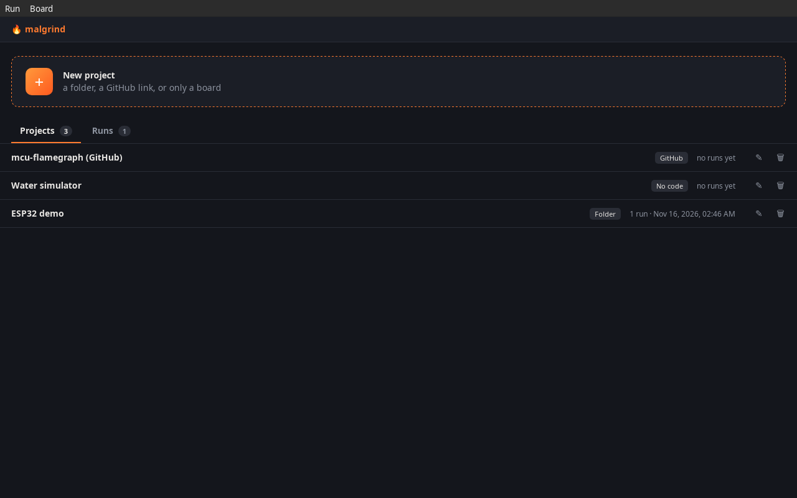

# malgrind

*valgrind for microcontrollers.* A desktop app that profiles the firmware running on your board **live**: a flamegraph,
a function table, and a history of runs you can reopen, rewind and rename. Today it supports the **ESP32** (ESP-IDF),
on Linux (`.deb`); macOS is written for but not yet tried on a Mac.


*A live run of the demo firmware (`firmware/esp32`): both cores, wide = more CPU time, stacked = call chain.*

## How it works

```
 your ESP32 + agent                         malgrind-cli (C++20 engine)                       malgrind (app)
 timer ISR -> unwind stack ->    UART       decode frames + CRC resync -> addr2line ->        Tauri window,
 count identical stacks on    -------->     aggregate -> run store (history)           ---->  TypeScript UI:
 the chip, send small frames  (921600)      builds/flashes through PlatformIO       JSON lines  flamegraph, functions,
                                                                                    on stdio    time scrubber, history
```

- The **agent** is a small piece of C++ in your firmware. malgrind adds it **at build time**; your source files are never
  touched. It samples where the CPU is about 1000 times a second per core, costing about 1.5 % CPU.
- **`malgrind-cli`** is the engine: serial port, build and flash, symbols, analysis and history. The app spawns it as
  `malgrind-cli serve`; in a terminal it is a tool of its own (see below).
- The **app** (Tauri: a thin Rust shell and a TypeScript UI) only draws what the engine computes.

## Install

Download from the repository's **Releases** page:

- **Linux:** `malgrind_<version>_amd64.deb` (Ubuntu 24.04 or newer), then `sudo apt install ./malgrind_<version>_amd64.deb`.
  It installs the app (`malgrind`) and the terminal tool (`malgrind-cli`).
- **macOS:** `malgrind_<version>_aarch64.dmg` (Apple silicon, macOS 13.3 or newer). It is only ad-hoc signed, not notarized, so
  macOS will warn on the first start: allow it in System Settings, Privacy & Security ("Open Anyway"), or run
  `xattr -dr com.apple.quarantine /Applications/malgrind.app`. **Built by CI, never yet tried on a Mac.**

`SHA256SUMS` lists the checksums of the files.

## Using the app



A **project** is what you profile. Its source code is optional, so a board whose firmware nobody has can still be attached to.

- **First start:** a big **New project**. Later it sits on top of the start screen, and under it two tabs list your **Projects**
  (each with its runs) and all **Runs**. Click a project to open it, a run to replay it; ✎ renames, 🗑 deletes.
- **New project:** drop a project folder on the window (or *Choose folder*), paste a **GitHub link** (public repositories; it is
  cloned once into malgrind's own folder), or take **No code, just a board** (optionally with its `.elf` for function names).
  Your own folder is used in place and never changed. A project cloned from GitHub must be **trusted** by you before it is built,
  because building runs the repository's PlatformIO scripts.
- **Profile** (on the project page): pick the **board** (a large tile per plugged-in serial port, with its USB adapter and whether
  the malgrind agent answers; it only listens), then **how**:
  - **Attach**: watch firmware that already runs the agent, without flashing or resetting it.
  - **Build & flash**: builds your project with the agent and flashes it, then shows the live flamegraph.
  - **Debug probe**: profile without touching the firmware; greyed, *in development*.
  A card that is not possible says what is missing (for example "this project has no source code").

  
- **Safe flash.** The first time the agent goes onto a board, malgrind reads the board's whole flash into
  `~/.local/share/malgrind/backups/<board MAC>/<time>.bin` (about a minute); if that fails, nothing is flashed.
- **Remove agent…** (bottom left of a run, or the Board menu) writes that backup back, byte for byte, so the board runs the
  firmware it had before, even if nobody has its source. "Rebuild my project instead" flashes a project built without the agent.

Views: **Flamegraph** (core and time-window filters, smoothed so it does not flicker) and **Functions** (self and inclusive
time per function; click one to see who calls it and what it calls). The slider at the bottom moves through time, in a live run
and in a replay.

Needs [PlatformIO](https://platformio.org) (`pip install platformio`) for *Build & flash* and *Rebuild*, and `git` for GitHub links;
attaching to a board that already runs the agent needs neither. Projects must use the ESP-IDF framework (`framework = espidf`) and a
path without spaces (PlatformIO's own limit).

## Terminal mode: `malgrind-cli`

The same package installs `malgrind-cli`, the engine with a localhost live page, for terminals and servers:

```bash
malgrind-cli run      # builds your project with the agent, flashes it, opens the live flamegraph in the browser
malgrind-cli attach   # the board already runs the agent: just show it
malgrind-cli detect   # which chip is connected?
malgrind-cli restore  # write back the backup `run` took before it flashed the agent
```

Everything is detected, each guess is printed. Runs go into the same history the app shows.

| detected | how | override |
|---|---|---|
| serial port | the only `/dev/ttyUSB*` / `/dev/ttyACM*` (none or several: it says so and lists them) | `--port` |
| PlatformIO project | `.` or the only `firmware/*/platformio.ini` | `--project` |
| environment | the project's `default_envs` | `--env` |
| firmware ELF (function names) | the agent build, else the newest `.pio/build/*/firmware.elf` or `build/*.elf` whose machine type matches the chip | `--elf` |
| viewer port | 8000, or the next free one | `--http-port` |

Also `--name`, `--no-open`, `--folded FILE` (folded stacks for `flamegraph.pl` / speedscope), `--data-dir`, `--agent-dir`.

## Status

| | |
|---|---|
| Linux app (`.deb`), start screen, history, New run, attach, remove agent | done, verified on an ESP32-D0WD-V3 board |
| Projects (folder, GitHub, no code), board tiles, methods, trust for cloned projects | done; the app was driven on a real USB port and a real GitHub clone worked; drag and drop not exercised |
| Flash backup before the agent, restore on remove | done, verified on the ESP32-D0WD-V3 dev board: backup, agent flash and live data, restore, `esptool verify_flash` matched |
| Profiling without flashing (JTAG/SWD probe through OpenOCD): Cortex-M first, then ESP32 | planned, see the design (section 5a) |
| Flamegraph and function table, live and replayed, time scrubber | done |
| `malgrind-cli run / attach / detect` | done |
| macOS `.dmg` | not yet (the code is portable; CI builds and tests on macOS) |
| Heap, FreeRTOS tasks, memory-error views (massif / memcheck-like) | planned: needs an agent that reports them, see the design |
| Diff of two runs, export | planned |
| STM32 / RP2040 / RISC-V ports, probe-based attach | not started, see `platforms/stm32/README.md` |

Measured on the ESP32 (160 MHz, 2 cores, demo firmware): 997 Hz per core = 2000 samples/s, 0 dropped, about 1.5 % overhead.
The design is in `docs/superpowers/specs/`, the implementation plan in `docs/superpowers/plans/`.

## Releasing

One version for everything: the `VERSION` file. `scripts/version.mjs` writes it into the app, the Rust shell and the lock file
(the C++ engine reads `VERSION` when it is built), and CI checks that they agree.

```bash
node scripts/version.mjs set 0.2.0          # or 0.2.0-rc.1 for a pre-release
git commit -am "release 0.2.0"
git tag v0.2.0 && git push --follow-tags
```

Pushing the tag starts `.github/workflows/release.yml`: it checks that the tag is `v` + `VERSION`, builds the `.deb` (Ubuntu 24.04)
and the `.dmg` (macOS, Apple silicon) in parallel, smoke-tests each package (version, engine starts, agent sources inside) and
publishes both, with checksums, as a GitHub Release. A tag with a dash is marked a pre-release; re-running the workflow replaces the files.

## Build from source

Needs CMake >= 3.20 and a C++20 standard library with `<format>` (GCC >= 13, or Apple Clang 15+ / LLVM 17+ on macOS 13.3+).
The app also needs Node with pnpm, a Rust toolchain, and (Linux) `libwebkit2gtk-4.1-dev`, `librsvg2-dev`,
`libayatana-appindicator3-dev`.

```bash
# the engine and its tests (no board needed)
cmake -B build && cmake --build build && ctest --test-dir build

# the app
cd app && pnpm install
pnpm test                                    # UI tests
pnpm tauri dev                               # run the app (builds the engine first)
pnpm tauri build --bundles deb               # app/src-tauri/target/release/bundle/deb/malgrind_<version>_amd64.deb

# no board? a Linux process that profiles itself
./build/apps/host_runner/host_runner 60 | ./build/host/malgrind-cli attach --port - --elf ./build/apps/host_runner/host_runner
```

`malgrind-cli` finds the agent sources next to itself (the app's resources) or in `$MALGRIND_AGENT_DIR`; a source build
falls back to this repository.

## The agent on the ESP32

- Sampling uses one `gptimer` per core (997 Hz by default; prime, so it never aliases with the RTOS tick) and ESP-IDF's own
  `esp_backtrace_*` unwinder. The ISR is IRAM-safe (`CONFIG_GPTIMER_ISR_IRAM_SAFE`).
- It starts itself from a constructor, so your firmware needs no call. malgrind builds with `agent/esp32/inject.py` (a PlatformIO
  pre-script), your `sdkconfig` plus `agent/esp32/sdkconfig.agent` (console at 921600), all inside `<project>/.pio/malgrind/`.
  The notes in `host/src/pio.hpp` explain what that took.
- UART0 uses the interrupt-driven driver with a TX ring buffer; plain stdout busy-waits and would dominate the profile.
  `ESP_LOG` text on the same UART still arrives (the engine separates it from frames).
- The two innermost frames of every raw stack are the sampler itself. `MALGRIND_ESP32_SKIP=2` removes them; if an IDF update
  changes the interrupt path, extra frames show up at the leaves, adjust the value.
- ROM functions (`0x4000xxxx`) show as raw addresses (needs Espressif's ROM ELF, not done).

### Measuring overhead

The header shows `overhead = (ISR + flusher cost) / CPU`. The ISR part contains `MALGRIND_ESP32_DISPATCH_CYCLES`
(1400 cycles at 160 MHz) for the interrupt entry and exit that cannot be timed from inside the callback. To recalibrate after an
IDF or clock change, flash the plain firmware and the agent build (same source) and compare the `iterations/s` log line:

```bash
cd firmware/esp32
pio run -e esp32dev -t upload --upload-port /dev/ttyUSB0    # plain: no profiler
# agent build: what the app runs (see host/src/pio.hpp), sdkconfig = yours + agent/esp32/sdkconfig.agent
MALGRIND_AGENT_DIR=$PWD/../../agent/esp32 MALGRIND_SDKCONFIG=$PWD/.pio/malgrind/sdkconfig.esp32dev \
PLATFORMIO_EXTRA_SCRIPTS=pre:$PWD/../../agent/esp32/inject.py PLATFORMIO_BUILD_DIR=$PWD/.pio/malgrind/build \
  pio run -e esp32dev -t upload --upload-port /dev/ttyUSB0
```

Adjust the constant until the header's percentage matches `1 - profiled/plain`. Not included: the UART driver's own
interrupts. The rate is `MALGRIND_RATE_HZ` (default 997).

## Limits

- Overhead is small, not zero; it grows linearly with the rate (about 1.5 % per 1000 Hz per core at 160 MHz).
- Code inside critical sections, or in interrupts above the timer's priority, is attributed to whatever runs next.
- Inlined and tail-called functions vanish from stacks; stacks deeper than 16 frames are cut.
- Each core needs its own timer; one core cannot sample the other.
- At most 128 distinct stacks per core per flush (250 ms); the rest is counted in `dropped`.
- Sampling is statistical: a short window holds few workload cycles, so use 30 s or more for a calm picture.

## Adding an MCU

The core knows nothing about chips. A port (`platforms/<mcu>/`, about 150 lines) does:

1. start a periodic timer on every core; in its ISR unwind the stack (innermost frame first) and call
   `Profiler::record(core, pcs, n, isr_cycles)`;
2. periodically call `Profiler::flush(write, settle, last_flush_cycles)`: `write(ptr, len)` sends bytes (UART),
   `settle()` waits at least one sample period so an in-flight ISR finishes;
3. fill `TargetInfo` (name, `Arch`, CPU Hz, cores). The engine picks `addr2line` from `Arch`.

Code the ISR runs must be placed in fast memory on some chips: mark it with `MALGRIND_ISR` (on ESP32 it is force-inlined into
the IRAM callback). Wire format: `core/include/malgrind/profiler.hpp`.

## Layout

```
core/            freestanding C++20 agent engine: stack table, double buffer, wire encoder (+ tests/)
platforms/host   Linux port (SIGALRM + backtrace)    platforms/esp32  ESP-IDF port    platforms/stm32  notes only
agent/esp32      the agent as an ESP-IDF component + the PlatformIO pre-script and sdkconfig that inject it
apps/host_runner demo workload that profiles itself
firmware/esp32   PlatformIO + ESP-IDF demo project (knows nothing about malgrind)
host/            malgrind-cli: wire decoder, symbolizer, aggregator, run store, sessions, PlatformIO, `serve` protocol,
                 terminal mode and its live page (+ tests/)
app/             the desktop app: Tauri shell (src-tauri/) and the TypeScript UI (src/)
```

About 70 % of the code is C++ (the agent, the ports and the whole engine); the app's TypeScript only draws.

Prior art studied: [esp32-semihosting-profiler](https://github.com/open-pe/esp32-semihosting-profiler),
[Zephyr perf](https://docs.zephyrproject.org/latest/services/profiling/perf.html),
[orbuculum](https://github.com/orbcode/orbuculum).
