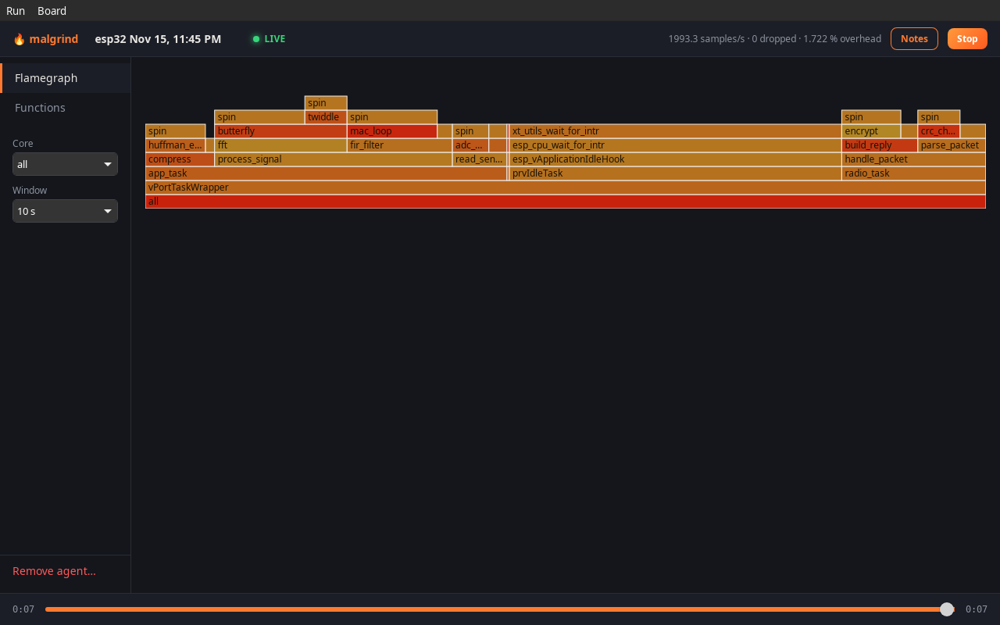
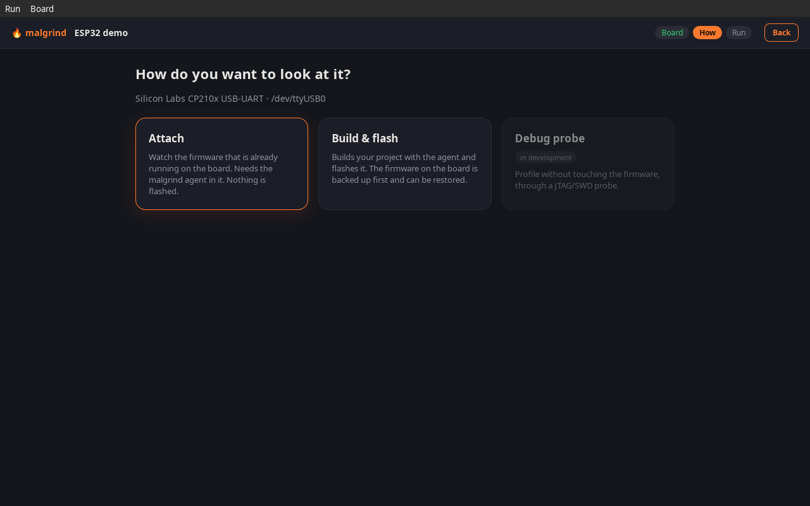

# malgrind

*valgrind for microcontrollers.* A desktop app that profiles the firmware running on your board **live**: a flamegraph,
a function table with per-function time series, heap memory and FreeRTOS task views, opt-in memory-error & leak checks,
run comparison, export, and a history of runs you can reopen, rewind, annotate, and rename. Today it supports the
**ESP32** (ESP-IDF), with host/agent support implemented for **STM32**, **RP2040**, and **OpenOCD debug probes (no flashing)**, on **Linux** (`.deb`), with **macOS** (`.dmg`) and **Windows** (`.exe` NSIS) support written and configured in CI (`ci.yml` builds and tests all three; macOS, Windows, STM32/RP2040, and OpenOCD hardware verification await runs on those machines per `docs/verification.md`).



*A live run of the demo firmware (`firmware/esp32`): both cores, wide = more CPU time, stacked = call chain.*

## How it works

```
 your MCU + agent                           malgrind-cli (C++20 engine)                       malgrind (app)
 timer ISR / hooks -> unwind ->  UART       decode v1/v2 frames + CRC -> addr2line ->       Tauri window,
 aggregate stacks, heap, tasks --------->   aggregate, series, memcheck, diff, export ----> TypeScript UI:
 & alloc events on the chip   <---------    build/flash via PlatformIO, device store  JSON  flamegraph, functions,
                               (921600)                                               lines memory, tasks, memcheck, diff
```

- The **agent** is a small piece of C++ in your firmware. malgrind adds it **at build time**; your source files are never
  touched. It samples where the CPU is about 1000 times a second per core, costing about 1.5 % CPU.
- **`malgrind-cli`** is the engine: OS abstraction (`host/src/os/`), chip families (`host/src/families/`), serial/byte
  sources, PlatformIO orchestration, symbolizer, analyzers, diff/export, and run store. The app spawns it as
  `malgrind-cli serve`; in a terminal it is a tool of its own (see below).
- The **app** (Tauri: a thin Rust shell and a Svelte/TypeScript UI) only draws what the engine computes.

## Install

Download from the repository's **Releases** page:

- **Linux:** `malgrind_<version>_amd64.deb` (Ubuntu 24.04 or newer), then `sudo apt install ./malgrind_<version>_amd64.deb`.
  It installs the app (`malgrind`) and the terminal tool (`malgrind-cli`). (`tauri.conf.json` configures `"targets": "all"`,
  while `.github/workflows/release.yml` packages `.deb`.)
- **macOS:** `malgrind_<version>_aarch64.dmg` (Apple silicon, macOS 13.3 or newer). It is only ad-hoc signed, not notarized, so
  macOS will warn on the first start: allow it in System Settings, Privacy & Security ("Open Anyway"), or run
  `xattr -dr com.apple.quarantine /Applications/malgrind.app`. **Configured in CI; packaging and hardware verification on a Mac are pending (`docs/verification.md`).**
- **Windows:** `malgrind_<version>_x64-setup.exe` (Windows 10 1809+ or Windows 11, x86-64 NSIS installer). Configured with
  Tauri's WebView2 `downloadBootstrapper` (downloads the WebView2 Runtime if missing) and installs both `malgrind` and
  `malgrind-cli.exe` (silent install supported with `/S /D=<dir>`). **Configured in CI; packaging and hardware verification on Windows are pending (`docs/verification.md`).**

`SHA256SUMS` lists the SHA-256 checksums of the release files.

## Using the app


A **project** is what you profile. Its source code is optional, so a board whose firmware nobody has can still be attached to.

- **First start:** a big **+ New project**. Later it sits on top of the start screen, and under it two tabs list your
  **Projects** (each with its runs) and all **Runs**. Click a project to open it, a run to replay it; `✎` renames a project
  or opens a run's inline **Name** and **Notes** editor (runs with notes show a `📝` preview); `🗑` deletes.
- **Run sizes:** each run row displays its on-disk size (`frames.mlg`, `meta.json`, and optional `firmware.elf`). If a live
  run reaches **200 MB** on disk, malgrind shows a dismissible notice (`"this run has reached ... MB on disk"`).
- **Compare / Diff:** in the **Projects** or **Runs** list, select any two runs (`A` baseline and `B` target) and click
  **Compare**. The **Compare runs** screen shows a **Differential flamegraph** (frame widths from `B`; **Red** = grew in `B`,
  **Blue** = shrank in `B`, neutral within ±0.05%) and a normalized **Functions** table (`A self %`, `B self %`, `Δ self`,
  `A incl %`, `B incl %`, `Δ incl`, sorted by `|Δ self|` by default) aggregated by function name across each run's own ELF,
  with a core filter and **Swap A ↔ B**. Compare works even while another run is live.
- **New project:** drop a project folder or `.elf` onto the window (or click *Choose folder…*), paste a **GitHub link**
  (public repositories; shallow-cloned once into malgrind's own folder), or pick **No code, just a board** (optionally with
  its `.elf` for function names). Your own folder is used in place and never changed. A project cloned from GitHub must be
  **trusted** by you before it is built, because building runs the repository's PlatformIO scripts.

### Choosing a board

- **Stable, OS-neutral `device_id`s:** malgrind identifies each serial device by a normalized `device_id` (`usb-<vid>-<pid>-sn-<serial>`
  when the USB adapter reports a serial number, `usb-<vid>-<pid>-at-<location>` from its physical USB socket/bus location
  when there is no serial, or `port-<name>` fallback). Your selection stays stable across USB replugs and OS port
  renumbering (Linux `ttyUSB*`/`ttyACM*`, macOS `/dev/cu.usb*`, Windows `COM*` / `COM10+`).
- **Why some tiles say `"probably"`:** native-USB boards such as Espressif USB-Serial/JTAG (`VID 303a`) carry a chip-specific
  USB ID, so their tile shows a muted **`probably ESP32 (ESP-IDF)`** hint before probing. Generic USB-UART bridges
  (WCH CH340/CH343, Silicon Labs CP210x, FTDI, Prolific PL2303) can sit in front of any MCU, so malgrind **never guesses**
  their chip until probed (either passively listening for a running agent frame, or when you click *Identify chip (resets the board)*).
- **Differentiating identical boards:** each tile shows the USB adapter title, short port name, physical USB location
  (`USB ...`), and adapter serial number (if present). Two identical boards—even serial-less adapters plugged into different
  USB ports—get distinct `device_id`s, and the settings panel names the exact chosen board (`Build & flash on <adapter> · <port/location>`)
  before flashing.
- **Debug probes:** discovered USB probes (ST-Link, SEGGER J-Link, CMSIS-DAP / DAPLink, Raspberry Pi Debug Probe, Olimex,
  FTDI FT2232/FT232H, and built-in USB-JTAG bridges) appear as selectable device tiles for **Debug probe** runs.

### Profiling, settings, notes, and export

- **Profile** (on the project page): pick the **board** or **debug probe**, then **how**:
  - **Attach**: watch firmware that already runs the agent, without flashing or resetting it.
  - **Build & flash**: builds your project with the agent and flashes it, then shows the live profile.
  - **Debug probe**: profile flat PCs over OpenOCD (DWT PCSR on Cortex-M3+ or halt/`reg pc`/resume) without modifying firmware (`probe_run`).
  A card that is not possible says what is missing (for example `"this project has no source code"` or `"choose the chip target config for OpenOCD"`).
- **Run settings, before every run:** choosing Attach, Build & flash, or Debug probe opens a panel with what malgrind detected, all editable:
  the **Project name**, **Run name**, PlatformIO **Environment**, **Sampling rate** (default 997 Hz per core), **Firmware ELF**
  (function names), **OpenOCD target config** (in Debug probe mode, with dynamic suggestions from the active family plus custom `target/*.cfg`),
  **Extra pio arguments**, and **Extra build flags** (`-D…`). When the target family supports it
  (`caps.memcheck`, such as ESP32), *Build & flash* also offers **`Check memory errors (slower, more RAM)`** (`RunSettings.check_memory`,
  which builds with `CONFIG_MALGRIND_MEMCHECK=y` and `agent/esp32/sdkconfig.memcheck`). Under *Advanced* are the two exact
  commands (build, then upload after backup); typing in one replaces the detected line (no shell is used: the line is split into
  words and run as it is, with the agent's environment kept). The panel starts from what the project used last time, *Reset to
  detected* brings the detected values back, and each run keeps the settings it was made with (**Settings** button in the run header).

  
- **Safe flash & Remove agent…:** the first time the agent goes onto a board, malgrind reads the board's whole flash into
  `<data_dir>/backups/<board-key>/<time>.bin` (`~/.local/share/malgrind/` on Linux, `~/Library/Application Support/malgrind/`
  on macOS, `%LOCALAPPDATA%\malgrind\` on Windows); if that fails, nothing is flashed. **Remove agent…** (bottom left of a
  live run) writes that backup back byte for byte—even if nobody has the source—or rebuilds your project without the agent.
- **Notes & Export** (in the run header):
  - **Notes** toggles a per-run notes field saved automatically on blur (an accent dot indicates saved notes).
  - **Export ▾** saves **Folded stacks** (`.folded`, for `flamegraph.pl` / Speedscope), **Speedscope** (`.speedscope.json`,
    one sampled profile per core), **Flamegraph SVG** (`.svg`), or **Flamegraph PNG** (`.png`) (image export is enabled on the
    Flamegraph view when samples are present).

### Views

The sidebar switches between views (depending on agent capabilities) alongside **Core** and **Window** (`5 s`, `10 s`, `30 s`,
`60 s`, `whole run`) filters, while the bottom scrubber moves through time in both live runs (`Back to live`) and replays (`To the end`):

- **Flamegraph:** smoothed live/replay flamegraph (`blend`, reset when changing core, window, or scrubber position).
- **Functions:** table of self and inclusive CPU % per function; clicking a function sets focus, shows **Called by** /
  **Calls** in the side panel, and adds a **Samples/s** time-series strip for the focused function.
- **Memory** *(when the agent reports `kCapHeap`)*: one time-series chart per heap region (**Internal RAM**, **External PSRAM**,
  **IRAM (exec)**) plotting **Free**, **Min free**, and **Largest block** alongside **Total**.
- **Tasks** *(when the agent reports `kCapTasks`)*: sortable FreeRTOS task table showing **CPU %**, **Priority**, **Core**,
  **State**, and **Min stack free**, highlighting rows with `< 512 B` remaining stack watermark (`⚠`).
- **Memcheck** *(when built with `Check memory errors` / `kCapAllocs | kCapErrors`)*:
  - **Leaks** grouped by symbolized allocation stack and classified as **`Definitely`** (older than the configurable
    `Leak age (s)` threshold, default 30 s, and outside the top-N steady-state alloc/free churn sites) or **`Possibly`**,
    expandable to the full call stack, plus live heap totals (`live_allocs`, `live_bytes`).
  - **Errors** list showing allocation failures (`alloc_failed` with requested size and stack), periodic heap corruption
    (`heap_corrupt` from `heap_caps_check_integrity_all(false)`), and `stack_overflow` wire events if emitted by a target port.
  - **Dropped events banner:** if target ring buffers overflow during a burst, `kErrEventsDropped` reports the dropped event
    count so incomplete tracking is never silent.

### Compatibility & project limits

- **v1 / v2 compatibility:** the host decodes both wire v1 (`0.4.0`) and wire v2 frames forever; stored v1 runs replay and
  diff cleanly, and existing `<mac>/` backups restore. Agent v2 supports sleep mode (`HELLO` beacon every 1000 ms, ~0 CPU
  overhead until `START`) and defaults `CONFIG_MALGRIND_START_SAMPLING=y` so newly built boards also stream immediately to
  `0.4.0` hosts.
- **ESP32 ROM function names:** when PlatformIO has the `tool-esp-rom-elfs` package installed, `Esp32Family` automatically
  supplies the matching ROM ELF (`0x40000000–0x4006ffff`) to `Symbolizer` so ROM functions resolve to names instead of raw
  `0x4000xxxx` addresses.
- **Project constraints:** ESP32 projects must use the ESP-IDF framework (`framework = espidf`) and a path without spaces
  (PlatformIO's own limit). On Windows, if `%LOCALAPPDATA%` contains spaces or non-ASCII characters, malgrind stores managed
  projects/clones in `<SystemDrive>\.malgrind\projects` (and also checks `<SystemDrive>\.platformio`).

### Setup, done from the app

- **PlatformIO** (for *Build & flash*): when missing, the start screen and board step offer **Install PlatformIO**, which
  creates a Python environment in `~/.platformio/penv` (or `<SystemDrive>\.platformio\penv` on Windows) and installs
  `platformio` from pypi.org without administrator rights. On Windows, Python detection ignores the Microsoft Store
  `WindowsApps\python.exe` stub. The first build downloads your board's toolchain (about 1 GB). Attaching to a board that
  already runs the agent needs no PlatformIO.
- **Permission denied on the USB port** (Linux: you are not in the port's group, `dialout` on Ubuntu): the board's tile
  says so and offers **Grant access…**. One system password prompt (`pkexec`) sets an ACL on the port (working immediately
  until replug) and adds you to the group (holding across replugs after your next login). Without `pkexec`, the tile shows
  the two `sudo` lines.
- **git** is only needed for GitHub links. malgrind tells you if it is missing but does not install it.

## Terminal mode: `malgrind-cli`

The same package installs `malgrind-cli`, the engine with a localhost live page, for terminals and servers:

```bash
malgrind-cli devices          # list connected serial devices and debug probes (--probe checks for a running agent)
malgrind-cli run              # build your project with the agent, flash it, open the live flamegraph in the browser
malgrind-cli attach           # the board already runs the agent: just show it
malgrind-cli detect           # identify which chip is connected (resets the board)
malgrind-cli restore          # write back the backup `run` took before it flashed the agent
```

Everything is detected, and each choice is printed. Runs go into the same history the app shows.

| detected | how | override |
|---|---|---|
| serial device | the only USB serial device found (none or several: lists ids/paths/names or search hint) | `--device` (matches id, path, or name; `--port` is still accepted) |
| PlatformIO project | `.` or the only `firmware/*/platformio.ini` | `--project` |
| environment | the project's `default_envs` | `--env` |
| firmware ELF (function names) | the agent build, else the newest `.pio/build/*/firmware.elf` or `build/*.elf` matching the chip | `--elf` |
| viewer port | 8000, or the next free one | `--http-port` |

Also `--name`, `--no-open`, `--folded FILE` (folded stacks for `flamegraph.pl` / Speedscope), `--data-dir`, `--agent-dir`.

## Status

Synced with [`docs/verification.md`](docs/verification.md) (the source of truth for per-OS and per-hardware checklists):

### Platforms

| Platform | Automated Build & Tests | Packaging & Smoke Test | Manual App + Hardware Verification | Notes |
|---|---|---|---|---|
| **Linux** (`x86_64`, Ubuntu 24.04+) | **Verified locally** (`29/29` CTest suites, `80/80` UI Vitest tests + `svelte-check`, `tsc`, portability / C++-share / sidecar script tests pass) | **Configured** (`.deb` in `release.yml`, `targets: "all"` in `tauri.conf.json`) | **Partial** (pre-Stage-2 baseline verified on ESP32-D0WD-V3; Stage 2 `devices`/`families` refactor, drag-and-drop, real `pkexec`, "Flash this board" click, Agent v2/Memcheck, P9 OpenOCD hardware rate gate, and P10 STM32/RP2040 board tests remain open) | See `docs/verification.md` Linux checklist. |
| **macOS** (`aarch64`, macOS 13.3+) | **Configured in CI** (`macos-latest` in `.github/workflows/ci.yml`; not yet run on Mac hardware) | **Configured in CI** (`.dmg` in `release.yml`, ad-hoc signed) | **Not yet run** | IOKit port/USB enumeration (`ports_macos.cpp`, `usb_macos.cpp`) and `IOSSIOSPEED` await Mac hardware testing. |
| **Windows** (`x86_64`, Windows 10 1809+ / 11) | **Configured in CI** (`windows-latest` in `.github/workflows/ci.yml`; awaiting remote MSVC CI run) | **Configured in CI** (`.exe` NSIS + WebView2 `downloadBootstrapper` in `release.yml`) | **Not yet run** | `COM10+`, non-ASCII/space profile fallback (`C:\.malgrind\projects`), handle isolation (`PROC_THREAD_ATTRIBUTE_HANDLE_LIST`), and ESP32 flow await Windows runs. |

### MCU Families & Modes

| Family / Mode | Engine & Build Support | Automated Tests | Hardware Verification | Notes |
|---|---|---|---|---|
| **ESP32 (ESP-IDF)** (`esp32`, Xtensa / RISC-V) | Implemented (`host/src/families/esp32.cpp`, `agent/esp32/`, `platforms/esp32/`) | **Verified** (`families`, `pio`, `flash`, `devices`, `serve`, `session`, `cli`, `series`, `memcheck` pass on Linux; `esp32.cpp` compiled against stub IDF headers with ASan/UBSan for `CONFIG_MALGRIND_MEMCHECK=0/1`) | **Partial** (0.4.0 baseline run/attach/backup/`verify_flash` verified on ESP32-D0WD-V3; Stage 2 Agent v2, opt-in memcheck, and JTAG board tests still open) | Native USB (`VID 303a`) hints `esp32` tentatively; generic bridges stay neutral until probed. |
| **STM32 (Cortex-M)** (`stm32`, `ArmV7M`) | Implemented (`platforms/cortexm/`, `agent/stm32/`, `host/src/families/stm32.*`) | **Verified (host & mocked)** (`cortexm`, `families`, `pio`, `probe_config`, `serve`, `setup` pass on Linux; `autostart.cpp` syntax-checked on host; `arm-none-eabi-g++` cross-compile pending) | **Pending hardware** | `--wrap=SysTick_Handler` (leaf + LR depth-2) and OpenOCD SWD (`0x08000000`) zero-reset ID/backup/restore. |
| **RP2040 (Raspberry Pi Pico)** (`rp2040`, `ArmV7M` M0+) | Implemented (`platforms/cortexm/`, `agent/rp2040/`, `host/src/families/rp2040.*`) | **Verified (host & mocked)** (`cortexm`, `families`, `pio`, `boards`, `devices`, `probe_config`, `serve` pass on Linux; `autostart.cpp` syntax-checked on host; `arm-none-eabi-g++` cross-compile pending) | **Pending hardware** | `--wrap=isr_systick` + 1 us `TIMERAWL` scaling, `HaltResume` probe sampling, and OpenOCD (`0x10000000`) or `picotool` BOOTSEL backup (`2e8a:000c` stays generic). |
| **Debug probe (OpenOCD / SWD / JTAG)** | Implemented for flat sampling (`openocd`, `openocd_source`, `probe_config`, `ops`/`plan`/`serve` RPCs, selectable UI probe tiles & target `<datalist>`) | **Verified (scripted/mocked)** (`openocd`, `openocd_source`, `probe_config`, `settings`, `serve`, plus UI tests) | **Pending hardware (`T9.0` gate)** | P9 (`T9.1`–`T9.5`) host/RPC/UI verified via `fake_tool` & mocked TCL servers; physical ST-Link/Pico/ESP32 rate checks open in `docs/verification.md`. |

Baseline 0.4.0 measurement on the ESP32 (160 MHz, 2 cores, demo firmware): 997 Hz per core = 2000 samples/s, 0 dropped,
about 1.5 % overhead. Stage 2 Agent v2 sleep overhead and opt-in Memcheck overhead await real hardware measurement in
`docs/verification.md`. The design is in `docs/superpowers/specs/`, and the implementation plans are in
`docs/superpowers/plans/`.

## Releasing

One version for everything: the `VERSION` file. `scripts/version.mjs` writes it into the app, the Rust shell, and the lock
file (the C++ engine reads `VERSION` when it is built), and CI checks that they agree.

```bash
node scripts/version.mjs set 0.2.0          # or 0.2.0-rc.1 for a pre-release
git commit -am "release 0.2.0"
git tag v0.2.0 && git push --follow-tags
```

Pushing the tag starts `.github/workflows/release.yml`: it verifies that the tag matches `v` + `VERSION`, builds the Linux
`.deb` (Ubuntu 24.04), macOS `.dmg` (Apple silicon), and Windows NSIS `.exe` (`windows-latest`) in parallel, smoke-tests
each package (version, `malgrind-cli` starts, and `agent/{esp32,stm32,rp2040}/{family.json,inject.py}` are present), and publishes all three
with `SHA256SUMS` as a GitHub Release. A tag with a dash is marked a pre-release; re-running the workflow replaces the files.

## Build from source

Prerequisites:

- **C++20 engine (`malgrind-cli`):** CMake >= 3.20 and a C++20 standard library with `<format>`:
  - **Linux:** GCC >= 13
  - **macOS:** Apple Clang 15+ (Xcode 15) or LLVM 17+ on macOS 13.3+
  - **Windows:** Visual Studio 2022 / MSVC Build Tools (17.8+) with C++20 `<format>`
- **Desktop app (`malgrind`):** Node (22 in CI) with `pnpm`, a Rust toolchain, and:
  - **Linux:** `libwebkit2gtk-4.1-dev`, `libxdo-dev`, `libssl-dev`, `libayatana-appindicator3-dev`, `librsvg2-dev`
  - **Windows:** Microsoft Edge WebView2 Runtime (built into Windows 11; bootstrapped by the installer on Windows 10)

```bash
# Engine and tests (no board needed)
cmake -B build && cmake --build build -j && ctest --test-dir build --output-on-failure

# Desktop app
cd app && pnpm install
pnpm test                                    # UI unit tests
pnpm check                                   # svelte-check
pnpm tauri dev                               # run the app (builds malgrind-cli sidecar first)
pnpm tauri build --bundles deb               # or --bundles dmg (macOS) / --bundles nsis (Windows)

# Portability & C++ share checks (run from repo root)
node scripts/check-portability.mjs
node scripts/cpp-share.mjs
```

`malgrind-cli` finds the agent sources next to itself (`agent-src` / app resources) or in `$MALGRIND_AGENT_DIR`; a source
build falls back to this repository.

## The agent on the ESP32

- Sampling uses one `gptimer` per core (997 Hz by default; prime, so it never aliases with the RTOS tick) and ESP-IDF's own
  `esp_backtrace_*` unwinder. The ISR is IRAM-safe (`CONFIG_GPTIMER_ISR_IRAM_SAFE`).
- It starts itself from a constructor, so your firmware needs no call. malgrind builds with `agent/esp32/inject.py` (a PlatformIO
  pre-script), your `sdkconfig` plus `agent/esp32/sdkconfig.agent` (console at 921600, FreeRTOS trace/runtime stats), and
  optionally `agent/esp32/sdkconfig.memcheck` when *Check memory errors* is enabled, all inside `<project>/.pio/malgrind/`.
  The notes in `host/src/families/esp32.hpp` explain why.
- UART0 uses the interrupt-driven driver with a TX ring buffer (and non-blocking RX polling in `flusher_task` for v2 `COMMAND`
  frames); plain stdout busy-waits and would dominate the profile. `ESP_LOG` text on the same UART still arrives (the engine
  separates it from frames).
- The two innermost frames of every raw stack are the sampler itself. `MALGRIND_ESP32_SKIP=2` removes them; if an IDF update
  changes the interrupt path, extra frames show up at the leaves, adjust the value.
- ROM functions (`0x4000xxxx`) symbolize automatically when PlatformIO has `tool-esp-rom-elfs` installed; otherwise they
  show as raw addresses.

### Measuring overhead

The header shows `overhead = (ISR + flusher cost) / CPU`. The ISR part contains `MALGRIND_ESP32_DISPATCH_CYCLES`
(1400 cycles at 160 MHz) for the interrupt entry and exit that cannot be timed from inside the callback. To recalibrate after an
IDF or clock change, flash the plain firmware and the agent build (same source) and compare the `iterations/s` log line:

```bash
cd firmware/esp32
pio run -e esp32dev -t upload --upload-port /dev/ttyUSB0    # plain: no profiler
# agent build: what the app runs (see host/src/families/esp32.hpp), sdkconfig = yours + agent/esp32/sdkconfig.agent
MALGRIND_AGENT_DIR=$PWD/../../agent/esp32 MALGRIND_SDKCONFIG=$PWD/.pio/malgrind/sdkconfig.esp32dev \
PLATFORMIO_EXTRA_SCRIPTS=pre:$PWD/../../agent/esp32/inject.py PLATFORMIO_BUILD_DIR=$PWD/.pio/malgrind/build \
  pio run -e esp32dev -t upload --upload-port /dev/ttyUSB0
```

Adjust the constant until the header's percentage matches `1 - profiled/plain`. Not included: the UART driver's own
interrupts. The rate is `MALGRIND_RATE_HZ` (default 997).

## Limits

- Overhead is small, not zero; it grows linearly with the rate (about 1.5 % per 1000 Hz per core at 160 MHz). Opt-in
  memory-error tracing (`CONFIG_MALGRIND_MEMCHECK`) adds per-allocation backtrace/queue overhead and extra RAM.
- Code inside critical sections, or in interrupts above the timer's priority, is attributed to whatever runs next.
- Inlined and tail-called functions vanish from stacks; stacks deeper than 16 frames are cut.
- Each core needs its own timer; one core cannot sample the other.
- At most 128 distinct stacks per core per flush (250 ms); the rest is counted in `dropped`.
- Under `Check memory errors`, allocation/error ring buffers are fixed-capacity (`EventQueue<256, 16>`); overflows are
  reported via `kErrEventsDropped` rather than blocking or allocating inside hooks.
- Sampling is statistical: a short window holds few workload cycles, so use 30 s or more for a calm picture.

## Adding a family

The core and host core know nothing about specific chips or OS APIs. Adding support for a new MCU family takes three pieces:

1. **Target port (`platforms/<id>/`):**
   - Start a periodic timer on every core; in its ISR unwind the stack (innermost frame first) and call
     `Profiler::record(core, pcs, n, isr_cycles)`. Mark ISR-executed code with `MALGRIND_ISR`.
   - Periodically call `Profiler::flush(write, settle, last_flush_cycles)` (`write(ptr, len)` sends bytes over UART/CDC,
     `settle()` waits at least one sample period so an in-flight ISR finishes), and fill `TargetInfo` (name, `Arch`, CPU Hz, cores).
   - Optionally emit v2 `HELLO`, `HEAP`, `TASKS`, `ALLOCS`, and `ERROR` frames and parse host `COMMAND` frames via
     `core/include/malgrind/command.hpp`. Wire format: `core/include/malgrind/profiler.hpp`.
2. **Build integration (`agent/<id>/`):**
   - Include `agent/<id>/family.json` (`{"id":"<id>"}`) so runtime agent discovery recognizes the family directory, alongside
     whatever build pre-script and config fragments inject the agent into user projects without modifying user files.
3. **Host adapter (`host/src/families/`):**
   - Implement one subclass of `malgrind::host::Family` (`host/src/families/family.hpp`): `id()`, `name()`, `caps()`,
     `handles_arch()`, `project_problem()`, `agent_baud()`, `agent_commands()`, `addr2line_names()`, and optionally
     `identify()`, `read_flash()`, `write_flash()`, `is_agent_image()`, `extra_symbol_files()`, `family_hint_for_usb()`, and
     `usb_adapter_name()`.
   - Register the instance in `all_families()` inside `host/src/families/registry.cpp`.

Run `node scripts/check-portability.mjs` to enforce the boundaries: OS headers/`#ifdef`s belong only in `host/src/os/`,
and chip/toolchain specifics belong only in `host/src/families/`, `agent/`, and `platforms/` (`scripts/portability-allow.json`
stays `{"os": [], "chip": []}`).

## Layout

```
core/                         freestanding C++20 agent core: stack table, double buffer, v1/v2 wire encoders,
                              command parser, fixed-capacity event queues (+ tests/)
platforms/                    target ports: host (Linux SIGALRM), esp32 (ESP-IDF), cortexm (ARMv6-M/v7-M/v8-M)
agent/                        per-family build injection + family.json: esp32, stm32, rp2040
apps/host_runner/             demo Linux workload that profiles itself
firmware/esp32/               PlatformIO + ESP-IDF demo project (knows nothing about malgrind)
host/                         malgrind-cli engine (+ tests/):
  src/os/                       OS backends for Linux, macOS, and Windows (paths, process, serial, ports, usb, access, console, socket, tools)
  src/families/                 chip-family abstraction, registry, Esp32Family, Stm32Family, Rp2040Family
  src/                          wire decoder, ByteSource, OpenOCD runner & source, probe_config, symbolizer, analyzers, diff/export, store, sessions, PlatformIO, serve, CLI
app/                          desktop app: Tauri shell (src-tauri/), sidecar build script (scripts/), and Svelte/TypeScript UI (src/)
scripts/                      check-portability.mjs, cpp-share.mjs, version.mjs (+ node:test suites)
```

Measured C++ share: **`71.4% (14017 / 19628 lines)`** (from `node scripts/cpp-share.mjs` across `core`, `host`, `platforms`,
`agent`, `apps`, `app/src`, and `app/src-tauri/src`, excluding generated, vendored, and test files); the TypeScript UI only draws.

Prior art studied: [esp32-semihosting-profiler](https://github.com/open-pe/esp32-semihosting-profiler),
[Zephyr perf](https://docs.zephyrproject.org/latest/services/profiling/perf.html),
[orbuculum](https://github.com/orbcode/orbuculum).
