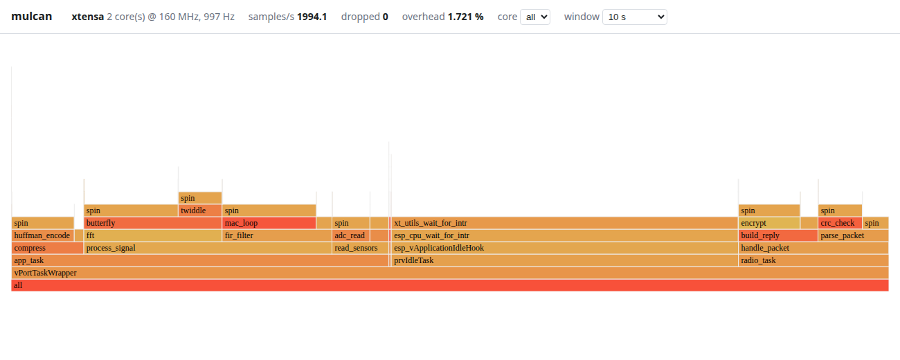

# malgrind

*valgrind for microcontrollers.* A sampling profiler for microcontrollers with a **live flamegraph**.
A timer interrupt on the MCU records where the CPU is (full call stack), counts identical stacks on the
device, and sends small frames over UART. The PC tool decodes them, resolves addresses to function names
with the toolchain's `addr2line`, and serves a live flamegraph in the browser.

All logic is C++20: the on-device engine (`core/`), the per-chip ports (`platforms/`) and the PC tool
(`host/`). The only non-C++ part is the web page (`host/web/flame.html`, JS + d3-flame-graph).

```
MCU:  timer ISR -> unwind stack -> hash table of stacks -> UART frame ("MLC1")
PC:   malgrind  -> decode + CRC resync -> addr2line (by arch) -> aggregate -> http://127.0.0.1:8000
```



*Live view of `firmware/esp32/main/main.cpp` on a real ESP32: both cores, wide = more CPU time, stacked = call chain
(`app_task` on core 0 with `fft -> butterfly -> twiddle -> spin`, `radio_task` on core 1, the idle task in the middle).*

## Where to see it

Start `malgrind run` (or `attach`): the browser opens by itself, or open **http://127.0.0.1:8000** (the exact address is printed). The page refreshes twice a second.
Hover a block for its name and share, click it to zoom, use the selectors for one core and for the time window
(5, 10, 30, 60 s or everything since start), and a pause box to freeze the picture while you read it.
The header shows samples/s, dropped samples and the overhead. Block widths are smoothed over time and a short
window holds few workload cycles, so use 30 s or more for a calm picture, 5 s to see changes quickly.
If the board stops sending, the page says so instead of keeping the last picture.

## Status

| | |
|---|---|
| Host (Linux) port, demo and tool | done, tested |
| ESP32 (Xtensa, ESP-IDF 5.3) port | done, verified on an ESP32-D0WD-V3 board |
| `malgrind run` (build + flash + view), `attach`, `detect` | done (ESP32 via PlatformIO + esptool) |
| STM32 / RP2040 / RISC-V ports | not started, see `platforms/stm32/README.md` |
| Probe-based attach (firmware without libmalgrind) | not started, see "Modes" |

Measured on the ESP32 (160 MHz, 2 cores, demo firmware):

| rate per core | samples/s | dropped | overhead reported | overhead measured (A/B) |
|---|---|---|---|---|
| 997 Hz | 2000 | 0 | 1.47 % | ~1.5 % |
| 5000 Hz | 9997 | 0 | 7.09 % | ~6.5 % |

"A/B" = iterations/s of a busy loop with and without the profiler, see "Measuring overhead".

## Platforms

| | Linux | macOS | Windows |
|---|---|---|---|
| `malgrind` tool (run / attach / detect, viewer) | yes, tested (GCC 15, clang 21) | written for it, **not yet run on a Mac** | no |
| ESP32 firmware (PlatformIO) | yes, tested on hardware | PlatformIO supports it | via PlatformIO, but the tool does not run |
| `host_runner` demo (profiles itself) | yes | no (needs a static non-PIE ELF and 32-bit addresses) | no |

Requirements for the tool: GCC >= 13, or Apple Clang 15+ (Xcode 15) / LLVM 17+ on macOS 13.3 or newer. CMake stops early
with a message if `<format>` is missing. macOS differences already handled: serial ports `/dev/cu.usb*` (not `tty.*`),
`select()` instead of `poll()` on devices, no `B921600` constants, `open` instead of `xdg-open`, no `MSG_NOSIGNAL`,
`std::thread` instead of `std::jthread`. The serial port is opened exclusively on both systems, so a second malgrind
reports "busy" instead of stealing bytes. A GitHub Actions workflow (`.github/workflows/ci.yml`) builds and tests on
Ubuntu and macOS on every push, which is the quickest way to find out whether the Mac build works.

Windows would need its own serial, process and socket code (Win32 instead of termios, `posix_spawn` and BSD sockets);
under WSL the Linux build works if the USB device is attached with `usbipd`.

## Build and run

Needs CMake >= 3.20 and a C++20 standard library with `<format>` (see Platforms).

```bash
cmake -B build && cmake --build build && ctest --test-dir build

# 1. no board: a Linux process that profiles itself
./build/apps/host_runner/host_runner 60 | \
  ./build/host/malgrind attach --port - --elf ./build/apps/host_runner/host_runner
# open http://127.0.0.1:8000   (expected: busy_a 60 %, busy_b 30 %, idle 10 %)

# 2. ESP32: needs PlatformIO (`pio`), which downloads ESP-IDF and the toolchain by itself
cd ~/CLionProjects/mcu-flamegraph
./build/host/malgrind run        # builds + flashes firmware/esp32, opens the live flamegraph in the browser
./build/host/malgrind attach     # firmware already runs: just show it
./build/host/malgrind detect     # which chip is connected?
```

Those three words are the whole interface: everything else is detected, and each guess is printed so you can see it.

| detected | how | override |
|---|---|---|
| serial port | the only `/dev/ttyUSB*` / `/dev/ttyACM*` (none or several: it says so and lists them) | `--port` (`-` = stdin) |
| PlatformIO project | `.` or the only `firmware/*/platformio.ini` | `--project` |
| environment | the project's `default_envs` | `--env` |
| firmware ELF (function names) | newest `.pio/build/*/firmware.elf` or `build/*.elf` in `.` or `firmware/*` whose ELF machine type matches the chip that sends the frames, so a stale or foreign ELF is never used | `--elf` |
| `addr2line` | from the chip architecture: PATH, then PlatformIO's toolchains | `--addr2line` |
| viewer port | 8000, or the next free one | `--http-port` |
| browser | opened automatically when a display exists | `--no-open` |

Not detected: the baud rate (921600, what libmalgrind uses; `--baud`). If no frames arrive in 5 s the tool hints at it.
`malgrind run --flash-cmd "..."` replaces the PlatformIO step with any build+flash command (other chips).
`--folded out.txt` writes folded stacks for `flamegraph.pl` / speedscope when the tool exits.

## Modes

1. **`run`** builds and flashes *your* firmware (linked with libmalgrind, one `malgrind_start()` call), then shows it live.
2. **`attach`** (2a): the firmware already runs libmalgrind; just listen. Works on every chip, no reset needed.
3. **Probe attach** (2b, future): firmware that knows nothing about malgrind, a debug probe reads the program counter
   (ARM Cortex-M `DWT_PCSR` without halting, or SWO PC sampling). Flat profile, zero overhead. The viewer only
   consumes decoded `Frame`s (`host/src/wire.hpp`), so a probe reader can feed it depth-1 frames later without
   touching the rest. On ESP32 a probe reads ~14 samples/s, so this mode only makes sense for ARM.

## Adding an MCU

The core knows nothing about chips. A port (`platforms/<mcu>/`, ~150 lines) does:

1. start a periodic timer on every core; in its ISR unwind the stack (innermost frame first) and call
   `Profiler::record(core, pcs, n, isr_cycles)`;
2. periodically call `Profiler::flush(write, settle, last_flush_cycles)`: `write(ptr, len)` sends bytes
   (UART), `settle()` waits at least one sample period so an in-flight ISR finishes;
3. fill `TargetInfo` (name, `Arch`, CPU Hz, cores). The host picks `addr2line` from `Arch`.

Code the ISR runs must be placed in fast memory on some chips: mark it with `MALGRIND_ISR`
(on ESP32 it is force-inlined into the IRAM callback). Wire format: `core/include/malgrind/profiler.hpp`.

## ESP32 notes

- Sampling uses one `gptimer` per core (997 Hz by default; prime, so it never aliases with the RTOS tick)
  and ESP-IDF's own `esp_backtrace_*` unwinder. The ISR is IRAM-safe (`CONFIG_GPTIMER_ISR_IRAM_SAFE`).
- UART0 uses the interrupt-driven driver with a TX ring buffer; plain stdout busy-waits and would dominate the
  profile. `ESP_LOG` text on the same UART still reaches your terminal (the tool separates it from frames).
- The two innermost frames of every raw stack are the sampler itself (`_xt_lowint1`, `gptimer_default_isr`).
  `MALGRIND_ESP32_SKIP=2` removes them; if an IDF update changes the interrupt path, extra frames show up at the
  leaves, adjust the value.
- ROM functions (`0x4000xxxx`) show as raw addresses (needs Espressif's ROM ELF, not done).

## Measuring overhead

The viewer shows `overhead = (ISR + flusher cost) / CPU`. The ISR part contains `MALGRIND_ESP32_DISPATCH_CYCLES`
(1400 cycles at 160 MHz) for the interrupt entry/exit that cannot be timed from inside the callback. To recalibrate
after an IDF or clock change, flash both firmwares and compare the `iterations/s` log line:

```bash
cd firmware/esp32
pio run -e esp32dev          -t upload --upload-port /dev/ttyUSB0    # with profiler
pio run -e esp32dev_baseline -t upload --upload-port /dev/ttyUSB0    # without (-DDEMO_PROFILER=0)
```

Adjust the constant until the viewer's percentage matches `1 - profiled/baseline`.
Not included in the figure: the UART driver's own interrupts. Rate test: `PLATFORMIO_BUILD_FLAGS="-DDEMO_RATE_HZ=5000"`.

## Limits

- Overhead is small, not zero; it grows linearly with the rate (about 1.5 % per 1000 Hz per core at 160 MHz).
- Code inside critical sections, or in interrupts above the timer's priority, is attributed to whatever runs next.
- Inlined and tail-called functions vanish from stacks; stacks deeper than 16 frames are cut.
- Each core needs its own timer; one core cannot sample the other.
- At most 128 distinct stacks per core per flush (250 ms); the rest is counted in `dropped`.

## Layout

```
core/            freestanding C++20 engine: stack table, double buffer, wire encoder (+ tests/)
platforms/host   Linux port (SIGALRM + backtrace)      platforms/esp32  ESP-IDF port      platforms/stm32  notes only
apps/host_runner demo workload that profiles itself
firmware/esp32   PlatformIO + ESP-IDF demo project (components/malgrind wraps core + port)
host/            `malgrind` tool: wire decoder, symbolizer, aggregator, HTTP server, web/flame.html (+ tests/)
```

Prior art studied: [esp32-semihosting-profiler](https://github.com/open-pe/esp32-semihosting-profiler),
[Zephyr perf](https://docs.zephyrproject.org/latest/services/profiling/perf.html),
[orbuculum](https://github.com/orbcode/orbuculum).
